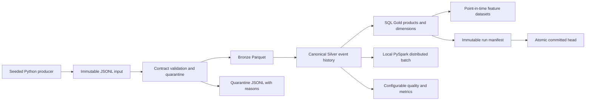
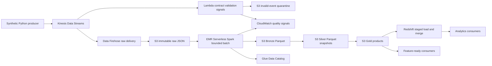

# Architecture

## Local development architecture

Python, DuckDB and PyArrow make the core runnable without AWS or Java. PySpark runs a separate tested batch on the same contracted input when Java is present. A local filesystem lock and atomic rename establish **single-host, single-writer** publication. They do not simulate S3 rename, Kinesis shards, IAM, EMR worker loss or Redshift distributed execution. An immutable run directory is readable only through a committed manifest; failed staging data is not a dataset.

## AWS deployment architecture

This is the target cloud design. Deployment assets and adapters must identify which arrows are executable and which still need a measured cloud acceptance run. AWS producers wrap arbitrary payload bytes in a valid JSON transport envelope containing record_id and payload_base64; Firehose inserts record delimiters. This preserves malformed payloads without ambiguous JSONL framing. Raw delivery is the authoritative processing source. Lambda is a separate low-latency quality signal/quarantine consumer; its output is never unioned with Firehose raw input. Duplicate validation is acceptable; duplicate canonical ingestion is not. Stream processing is at-least-once. Event-time lifecycle assembly happens in bounded batch because ordering across package/shipment streams and late events require history.

## Component purpose and trade-offs

| Component | Purpose | Cost or trade-off |
|---|---|---|
| Kinesis | Retention and independently replayable consumers; partition key order_id | Shard/capacity limits and skew; order is local to a shard, not global event time |
| Firehose | Buffered raw delivery without a bespoke long-running consumer | Adds latency and can duplicate; opaque raw bytes retained, no assumption of valid JSON |
| Lambda | Prompt contract rejection counts and source-addressed quarantine | Small bounded workload; not a stateful lifecycle processor; retries must not lose records |
| S3 | Immutable source, rejected records, run outputs and artifacts | Object storage has no filesystem rename; publication requires separate metadata protocol |
| Glue | Explicit catalog schemas and discoverability | Crawler inference is not a contract; partition/catalog changes need controlled publication |
| EMR Serverless | Partitioned Spark processing with bounded resource limits | Cold starts and minimum useful workload; local Spark proves logic, not AWS runtime behavior |
| Redshift | Dimensional serving and repeated analytical joins | Optional until workload justifies cost; physical layout determined by measured plans |
| CloudWatch | Metrics/logs and actionable alarms | Cardinality and retention cost; identifiers belong in logs, not dimensions |
| Terraform | Reproducible resource and IAM configuration | Provider lock and plan review required; validation is not deployment proof |

## Storage and publication

Raw data is append-only and partitioned by **arrival date/hour**, preserving late events without rewriting history. Bronze Parquet preserves original bytes, source locator, parse status and validation reasons for every input; accepted event fields are normalized in Silver. Silver contains one effective event per immutable event identity, with conflict detection; explicit correction references can supersede an earlier event. Gold grains are specified by product contracts. Event time determines business windows, ingestion time determines availability and freshness.

Partition curated output by UTC event date when scale warrants it; avoid facility/carrier high-cardinality partitions and compact small files. The initial bounded snapshot implementation is intentionally simple: one owner computes and validates a whole requested snapshot, then publishes a manifest. It does not claim row-level ACID or incremental Iceberg semantics. The initial implementation scans full retained history before producing a bounded business-date result. Backfills publish into a separate named range head; they cannot replace the complete current snapshot. Replaying a subset is not equivalent to a complete current snapshot.

The local publication protocol is implemented with an exclusive process lock, immutable snapshot paths and `os.replace` for the head file. Output checksums are verified on exact reruns; source hashes are rechecked before processing. Semantic quarantine records pending and overdue missing evidence, and all required product checks run before commit. AWS jobs write run-scoped prefixes and publish only after quality passes; S3 conditional writes or a supported catalog transaction are required to prevent lost updates. Glue tables must point to a committed immutable run, never a staging prefix. Until a cloud publication coordinator is implemented and exercised, unattended concurrent cloud publication is unsupported.

## Semantics

* Transport duplicate: identical event ID and business content; count once. Arrival metadata may differ.
* Identity conflict: same event ID with different business content; block publication or quarantine the conflicting ID. Never select an arbitrary latest payload.
* Late arrival: retained regardless of watermark; marks affected histories for recomputation. A 48-hour threshold is an alert/reconciliation policy, not a data deletion rule.
* Incompatible schema: preserved raw and quarantined. Additive supported versions normalize explicitly. Breaking versions require a new contract and compatibility tests.
* Incomplete lifecycle: distinguish pending/missing predecessor from impossible transitions. A delayed predecessor may repair the state on replay.
* Point-in-time features: only events with event time AND availability time no later than cutoff. Historical corrections become knowable at their own ingestion time. Filter by observation cutoff before resolving a correction chain; retain the original fact when its replacement was not yet available. All products and features publish through the same manifest.

## Evidence and operational limits

See `docs/phase-0-review.md`, `roadmap.md`, `reliability.md`, `benchmarks.md` and `cost.md` as milestones evolve. AWS sources consulted for design: [Firehose delivery failure semantics](https://docs.aws.amazon.com/firehose/latest/dev/data-transformation-failure-handling.html), [EMR Serverless Iceberg configuration](https://docs.aws.amazon.com/emr/latest/EMR-Serverless-UserGuide/using-iceberg.html), and [Redshift automatic table optimization](https://docs.aws.amazon.com/redshift/latest/dg/t_Creating_tables.html). These service documents support design choices; they do not constitute project performance evidence.

## Implementation boundary after the local milestones

The implemented local path writes 22 Parquet artifacts: Bronze, audit Silver history, effective Silver events, six contracted products, ten dimensional projections and three feature datasets. The three daily/hourly product tables support bounded backfill filtering in a separate namespace. Full entity/fact/feature artifacts retain complete context; this is documented behavior rather than general partition replacement.

The Spark job consumes the exact canonical Silver file from a committed manifest and writes three distributed serving projections. It uses shuffle aggregations, exploded order lines, joins, ranking and a time-range window. It is a separate validated computation, not a claim that all Python reconciliation has been ported to Spark.

AWS source adapters and Terraform are executable assets, tested with fake clients and provider validation. The Firehose capture bridge reads an explicitly named S3 object/version, preserves bytes and uses its original LastModified as a conservative batch availability time. Lambda uses Kinesis arrival for its independent signals. Automatically scheduled raw-to-Silver EMR processing, an S3/Glue release coordinator and Redshift loading are deployment acceptance work; no unattended full AWS pipeline is claimed.
