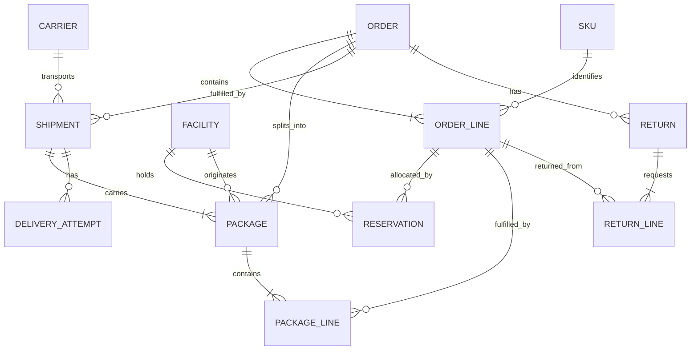

# Synthetic commerce domain

This design describes a fictional international commerce company. It contains no customer, employer, proprietary system, or production usage data. All identifiers, people, locations, transactions and operational incidents are generated. Country and currency codes are public standards. Version 1 deliberately models a small coherent operational domain rather than pretending to model every commerce operation.

## Entities and relationship boundaries

An order belongs to one synthetic customer and one destination country/region. It has one currency and one or more lines; `(order_id, line_item_id)` identifies a line. SKU, facility and carrier reference datasets are generated before dependent events. A line can be reserved across facilities and split among packages. A reservation identifies exactly one order line and one facility. A package belongs to exactly one order and one origin facility; each package line references a line of that order. A shipment carries one or more packages of the same order and origin facility, with one carrier. Each dispatched package belongs to exactly one shipment. Dispatch is the authoritative shipment-to-package membership declaration.

Reference facility location and order destination are distinct: envelope `country`/`region` always describe destination; facility metrics join their location from `silver.facilities`. For package scans, `payload.scan_location_id` identifies the observed scan location; envelope `facility_id` remains the fulfillment origin. Seeded carriers declare supported countries. No real customer name, address, contact information or payment information is generated.

`RETURN_INITIATED` describes a request against delivered units. It does not mean goods were received, refunded, or returned to available stock. The initial scope supports whole-order cancellation before any shipment dispatch. Partial cancellation, exchanges, split-currency orders, tax, discounts, shipping fees, warehouse stock receipts, and return receipt/refund events require explicit future contract additions.

## Quantities and money

Quantities are positive integer units. `order_total_minor = sum(line.quantity * line.unit_price_minor)`; minor-unit precision comes from the currency reference (JPY zero decimals; EUR/USD/GBP/CAD/AUD two). Monetary totals never cross currency boundaries without a future explicit FX contract. A currency code is not an implicit exchange rate.

For each order line, total active allocations cannot exceed ordered quantity; packaged quantity cannot exceed the allocated quantity; dispatched package quantities cannot be duplicated between shipments. Initiated returns cannot exceed delivered quantities minus previous effective return requests. These are cross-record quality checks, not JSON Schema assertions.

The inventory product records reservation/release movements. Positive `reserved_quantity_delta` consumes available-to-promise allocation; release reverses it. Dispatch consumes the reservation in the operational state but does not create a synthetic release or claim an increase in availability. Summing the reservation ledger alone therefore cannot reconstruct current physical stock or the complete available-to-promise balance. Inventory risk features must state this limitation and may use outstanding undispatched reservations plus seeded stock snapshots with explicit observation times.

## Event identity and time

Every event has an immutable `event_id`. Retry/redelivery of the same semantic event retains that ID and body. The semantic digest excludes only transport-owned `ingestion_timestamp` and optional diagnostic `trace_id`; canonical JSON uses sorted object keys, preserves array order, and rejects non-finite numbers. Changing business content under an existing ID is a conflict, not a last-write-wins update.

`entity_type` and `entity_id` identify the aggregate; `entity_version` is a monotonically increasing positive source sequence. Entity mappings are:

| Events | Aggregate | Identity equality checked semantically |
| --- | --- | --- |
| ORDER_CREATED, ORDER_CANCELLED | order | entity_id = order_id |
| INVENTORY_RESERVED, INVENTORY_RELEASED | reservation | entity_id = payload.reservation_id |
| PACKAGE_CREATED, PACKAGE_SCANNED | package | entity_id = package_id |
| SHIPMENT_DISPATCHED, SHIPMENT_DELAYED, OUT_FOR_DELIVERY, DELIVERED, DELIVERY_FAILED | shipment | entity_id = shipment_id |
| RETURN_INITIATED | return | entity_id = payload.return_id |

Versions order changes within one aggregate; timestamps do not establish causality across aggregates. Gaps and missing parents are pending until a bounded reconciliation deadline rather than automatically treated as invalid at first sight. Two unrelated events claiming the same aggregate/version are a conflict. Event ID is a deterministic audit tie-break only.

`event_timestamp` is the business time in UTC. Accepted batch `ingestion_timestamp` is a trusted observation time: the original S3 raw object's persisted `LastModified` in AWS, conservatively later than stream arrival. Opaque Firehose delivery does not preserve stream metadata; the independent Lambda signal consumer records Kinesis `approximateArrivalTimestamp` only for that signal path. The raw frame retains original producer bytes. Wire events must include the ingestion field but may set it to null. Local fixtures supply a deterministic simulated ingress timestamp and label it as simulated, while local measured processing latency uses a separate wall clock. A durable first-received timestamp must survive retries and replay; a new replay run time or copied object's modification time is never used as the original availability time.

## Lifecycle rules

| Aggregate | Allowed progression |
| --- | --- |
| order | ORDER_CREATED then optional ORDER_CANCELLED; cancellation is prohibited after any effective dispatch |
| reservation | INVENTORY_RESERVED then one or more INVENTORY_RELEASED events whose cumulative units do not exceed reserve; dispatch consumes remaining allocation |
| package | PACKAGE_CREATED then zero or more PACKAGE_SCANNED events; scan stages can skip but cannot regress within a journey without an explicit correction |
| shipment | SHIPMENT_DISPATCHED → optional repeated SHIPMENT_DELAYED → OUT_FOR_DELIVERY → DELIVERED or DELIVERY_FAILED; failed attempt can be followed by delay or a new OUT_FOR_DELIVERY attempt |
| return | RETURN_INITIATED after the referenced units are delivered; later receipt/refund states are outside version 1 |

Delayed events may occur after dispatch, after a previous delay, after a failed attempt, or during an active delivery attempt. A delay does not create a new attempt. Every outcome must refer to the currently open `delivery_attempt_id`; the first attempt is 1, later attempts increase by one, and a completed attempt cannot have both delivered and failed outcomes. Delivery is terminal unless its evidence is corrected. A repeated distinct scan is a real operational event; repeated event IDs are delivery duplicates.

`promised_delivery_at` on dispatch is the original committed promise used for reliability. `revised_eta` is a forecast and does not move the SLA target. Out-of-order arrival changes when evidence is available, not lifecycle order. Events whose dependencies remain missing after the configured 48-hour reconciliation allowance enter a recoverable semantic quarantine; replay after the parent arrives can reconsider them.

## Historical corrections

A correction is a new immutable event with a higher aggregate version and `correction_of_event_id` pointing to an earlier event of the same aggregate and event type. Parent identities are immutable; correcting an order ID, package membership identity, carrier identity or origin facility requires a future explicit migration workflow. Correctable payload values and event time are validated against the whole affected history.

A correction replaces the original event's logical lifecycle position. Its higher `entity_version` orders the audit revision, not a new lifecycle occurrence. Resolve chains to a root event and retain the root's sequence as `logical_slot_version` while using the latest eligible revision's body and timestamp. Pending targets, cycles, self-references, forks that do not extend the currently effective revision, and cross-aggregate references must be rejected or held for reconciliation; never silently choose by arrival order. Corrections affect both old and new event-time partitions and all downstream products.

For point-in-time features, resolve only revisions with durable `first_received_at <= feature_as_of`. Before a correction arrived, the original event remains the historically available fact. Latest corrected products are unsuitable for historical features unless that availability filter is applied first. Training labels can be built separately after the outcome horizon.

## Operational products and analytical grains

The six machine-readable contracts in `contracts/products/` define reusable operational products. `inventory_movements` belongs in Silver because it is an auditable event-level product; the other products are Gold. Product consumers cannot infer a zero denominator to mean perfect performance, or average preaggregated percentages.

| Analytical table | Grain | Modeling notes |
| --- | --- | --- |
| fact_order_fulfillment | one row per order | Accumulating snapshot; amounts retain currency; fulfillment and initiated returns remain separate. |
| fact_shipment_delivery | one row per dispatched shipment | Accumulating snapshot with nullable terminal measures, original promise and outcome. |
| fact_inventory_movement | one row per effective inventory event and order line | Transaction fact; corrections replace effective rows but audit history remains available. |
| fact_facility_hour | one row per origin facility and UTC hour | Additive counts; duration averages use sum/count when reaggregating. |
| dim_date | one row per calendar date | UTC analytical calendar; local business calendars are future scope. |
| dim_facility, dim_carrier, dim_sku | one row per seeded immutable business key | Type 1 static synthetic reference data initially. Introduce SCD2 only with real historical attribute changes and valid-from/to joins. |

Destination geography is a small reusable dimension or explicit country/region attributes where join overhead is unjustified. A customer dimension is unnecessary for these operational questions. Facts are derived serving projections of products, not competing sources of truth.

## Feature lineage

| Feature | Lineage and calculation boundary |
| --- | --- |
| carrier_delay_rate_30d | available effective delivery events → shipment_lifecycle → carrier_performance numerator/denominator → prior 30 complete UTC days per carrier/country → delay prediction consumer |
| facility_volume_1h | available facility events → facility_performance → count within `[as_of - 1h, as_of)` → anomaly consumer |
| avg_dispatch_latency_7d | available package/dispatch events → shipment lifecycle join → facility dispatch duration sum/count → prior 7 days → delay prediction consumer |
| recent_failed_delivery_rate | available attempt outcomes → carrier_performance → failed/completed outcome counts over trailing 7 days → operational consumer |
| package_scan_gap_minutes | available package scan history → latest scan at cutoff → elapsed minutes to as_of, null before first scan → delay prediction consumer |

Windows are half-open and use event time after filtering by trusted availability time. Exact rolling windows crossing daily or hourly boundaries require underlying event facts; daily/hourly products alone cannot supply arbitrary cutoffs. Features carry `feature_as_of`, `source_snapshot_id`, and contract version. No models or claimed predictive performance are part of this project.
